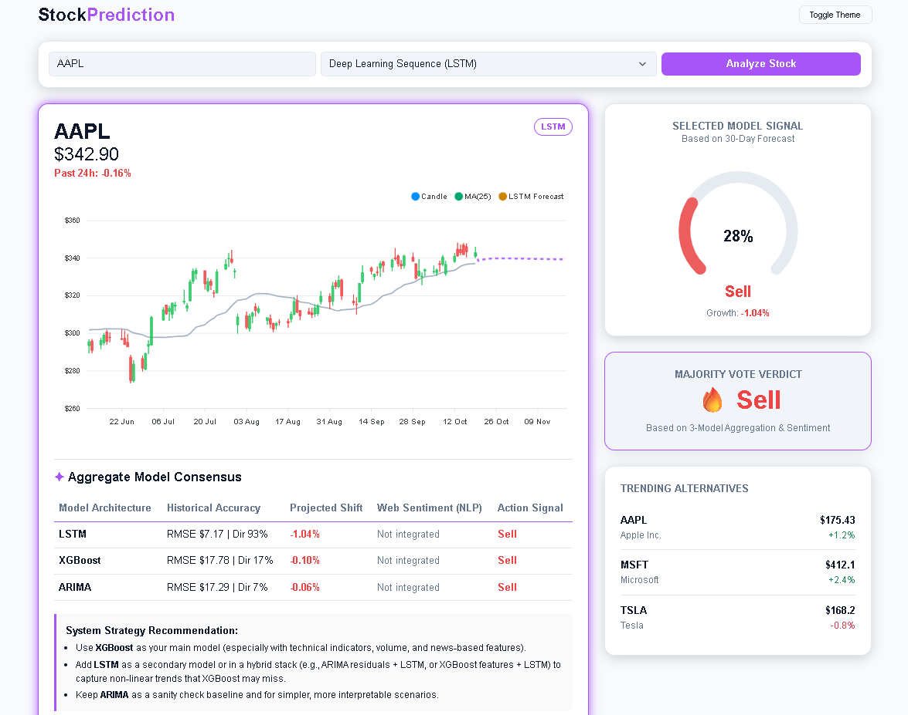
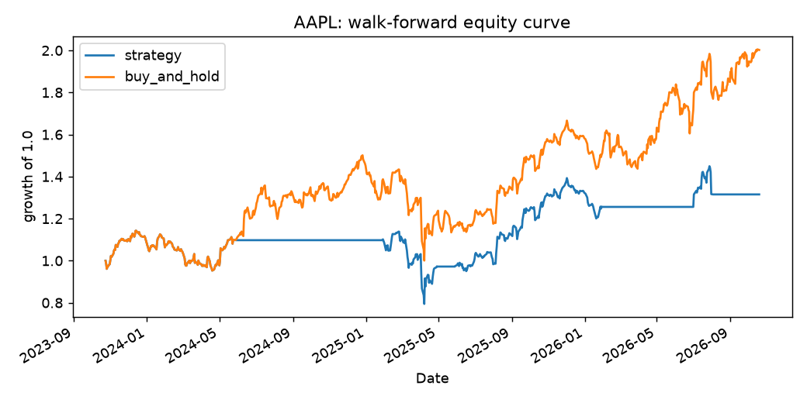
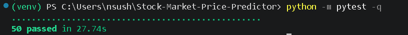

# StockPrediction: Multi-Model Stock Forecasting Terminal

[](https://github.com/N-Sushank-S-N/Stock-Market-Price-Predictor/actions/workflows/ci.yml)


A Flask web app that forecasts stock prices with three models (ARIMA, XGBoost, LSTM), shows each model's
measured hold-out error, and combines their signals into a majority-vote Buy / Hold / Sell verdict.
Built during a machine learning internship at HCL Technologies (Jun-Aug 2025) and extended afterwards with
real model implementations, a walk-forward backtest, automated tests and CI.



## How it works

```
[ yfinance ] -> [ data_engine.py ]  (MultiIndex flattening, lru_cache)
                       |
                [ inference.py ]
        ARIMA(5,1,0) | XGBoost (lagged returns) | LSTM (2x50, 60-day window)
                       |
        [ majority vote across available models; a tie resolves to Hold ]
                       |
              [ Flask  POST /predict ]
                       |
           [ ApexCharts.js dashboard ]
```

- **ARIMA**: statsmodels ARIMA(5,1,0), linear trend baseline.
- **XGBoost**: predicts the next daily return from the previous 10 returns and rolls forward (trees cannot extrapolate price levels).
- **LSTM**: TensorFlow, two 50-unit layers, 60-day window, 10 epochs. Optional: if TensorFlow is not installed the app marks LSTM "Unavailable" and the remaining models vote.
- **Accuracy column**: RMSE and directional accuracy measured on a 30-day hold-out the model never trained on.
- **Sentiment**: not integrated yet. The column is a labelled placeholder and nothing sentiment-related feeds the vote.

## Quick start

```bash
git clone https://github.com/N-Sushank-S-N/Stock-Market-Price-Predictor.git
cd Stock-Market-Price-Predictor
python -m venv venv
# Windows:   venv\Scripts\Activate.ps1      Linux/macOS: source venv/bin/activate
pip install -r requirements.txt     # includes TensorFlow for the LSTM
python app.py
```
Open http://127.0.0.1:5000, enter a ticker (for example AAPL), pick a model and click Analyze Stock.
The first request trains the models (about 30 seconds with LSTM); repeat requests are cached.

## Evaluation

**Hold-out**: the last 30 days are withheld, the model forecasts them, and the app shows RMSE plus directional
accuracy. This is one window per request, so treat it as indicative.

**Walk-forward backtest** (`python run_backtest.py --ticker AAPL`): every 21 trading days the models are
retrained on the previous 252 days only, forecast the next window, and the majority-vote signal is traded the
following day with 10 bps transaction costs. Results are compared with buy-and-hold on out-of-sample data.

AAPL, ARIMA + XGBoost, out-of-sample 2023-10-24 to 2026-10-19:

| | Strategy | Buy-and-hold |
|---|---|---|
| Total return | 31.5% | 100.2% |
| CAGR | 9.7% | 26.3% |
| Sharpe | 0.54 | 1.00 |
| Annualized volatility | 20.9% | 26.9% |
| Max drawdown | -30.5% | -33.4% |
| Trades | 4 | - |

The strategy **underperformed** buy-and-hold. ARIMA and XGBoost forecast small price moves, so signals rarely
fire and the strategy sat out much of a strong uptrend. With one stock, one period and 4 trades this is
indicative, not conclusive. MSFT results are in `results/backtest_MSFT.csv` and `results/equity_MSFT.png`.



## Tests and CI

`python -m pytest -q` runs 50 offline tests covering API contract and validation, error handling, model
behaviour (determinism, no training on the test window) and backtest correctness (no lookahead, costs,
drawdown). GitHub Actions runs them on every push (TensorFlow is skipped in CI to keep it fast).



## Project structure

```
app.py               Flask app and POST /predict
data_engine.py       data ingestion, caching, MultiIndex flattening
inference.py         ARIMA / XGBoost / LSTM forecasting and hold-out evaluation
backtest.py          backtest engine (no lookahead, costs, metrics)
run_backtest.py      walk-forward runner for real tickers
tests/               pytest suite
templates/           dashboard (ApexCharts.js)
results/             backtest tables, charts, screenshots
BUG_REPORT.md        defects found in the earlier version and how they were fixed
```

## Development notes

The first version (`v1-legacy` branch) used three separate training scripts and picked the single lowest-RMSE
model. The refactored version added the modular architecture and dashboard, but its inference layer was a
simulation. It has since been replaced with the real models above; the defects that surfaced (hard-coded
accuracy, random forecasts, fabricated sentiment, tie-breaking and input-validation bugs) are documented in
`BUG_REPORT.md`.

## Limitations

- Sentiment analysis is not implemented.
- The "Trending Alternatives" panel is static demo data.
- Forecasts use daily closes only; this is an educational project, not investment advice.
